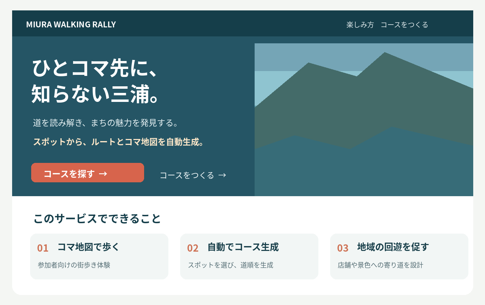
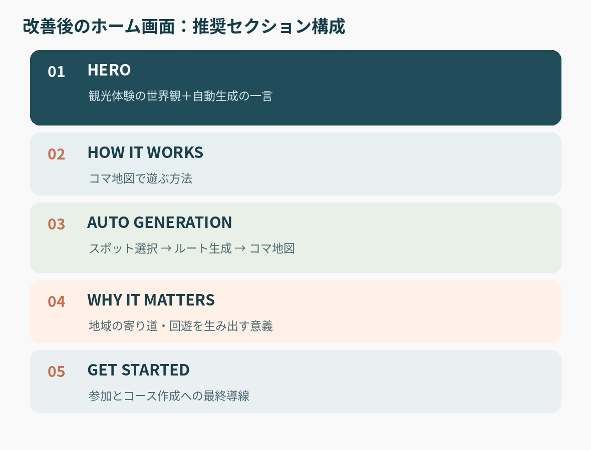
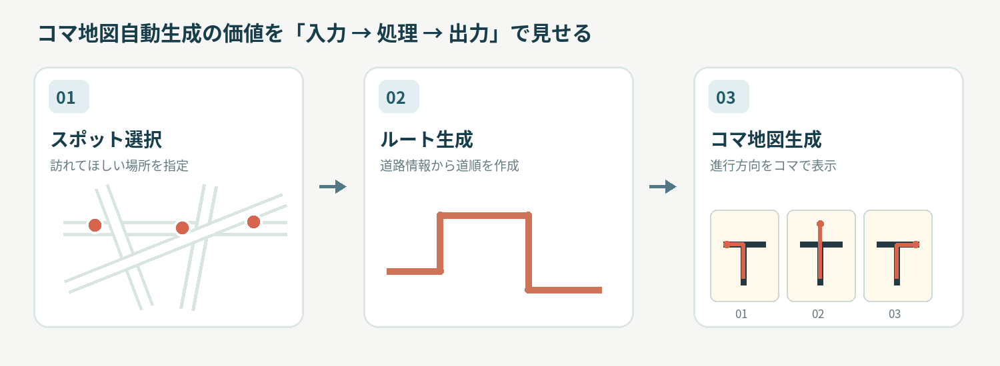

# 三浦市ウォーキングラリー｜ホーム画面改善提案

> **目的：ハッカソン審査員や初めて訪れた人に、観光体験の魅力と「コマ地図自動生成」という独自性を短時間で伝える。**
>
> 対象：参加者・運営者が共通して訪れるホーム画面  
> 根拠：現行ホーム画面のHTMLおよびこれまでの設計議論  
> ※掲載画像は情報設計を説明するための**コンセプト図**。現行画面のスクリーンショットではない。

## 1. 結論：ホームを「紹介ページ」として設計する

今回の最優先事項は、運営者が最短でログインできることではなく、**初見の審査員が何のサービスか、何が新しいのか、地域にどう役立つのかを直感的に理解すること**である。

- **主役：** 観光客がコマ地図で三浦を探検する体験
- **最大の差別化：** スポットの指定からルートとコマ地図を自動生成できること
- **事業価値：** 店舗・景色などへの寄り道を組み込んだ街歩きコースを運営側が作りやすくなること
- **運営者の導線：** 必ずしも最上位に置く必要はない。ヘッダーの控えめな入口と機能紹介内のCTAがあればよい

既存の「ひとコマ先に、知らない三浦。」というコピー、風景写真、ツナ之介、実際に操作できるコマ地図のデモは活かす。

## 2. 現行ホームの評価

現行HTMLでは次の構成が確認できる。

| 現行セクション | 役割 | 改善の方向性 |
|---|---|---|
| HERO | 三浦の魅力、キャッチコピー、参加・作成ボタン、コマ地図デモ | 世界観は維持。自動生成という独自性を一言追加 |
| INTRODUCTION | コマ地図の魅力と表示例 | HOW TO PLAYと整理・統合を検討 |
| HOW TO PLAY | 参加方法の3ステップ | 維持。説明は短く分かりやすく |
| DISCOVERY | まちの魅力・寄り道の訴求 | 地域価値の説明へ再構成 |
| CREATE A WALK | スポット選択、ルート生成、コマ地図 | **最重要セクションとして見せ方を強化** |
| GET STARTED | 参加者・運営者の最終導線 | 維持しつつ重複CTAを整理 |

### 課題

1. 観光体験の魅力はよく伝わる一方、**審査員には単なるウォーキングラリーアプリに見える可能性**がある。
2. 自動生成の価値がファーストビューでは十分に伝わらない。
3. 説明セクションが多く、メッセージが分散しやすい。
4. 参加者・運営者のCTAが複数箇所にあり、視線が散る可能性がある。

※「ページが長い」「分かりにくい」は実利用テストで確認された事実ではなく、現行構成に基づくUX上の仮説。

## 3. 推奨する全体構成

| 順序 | セクション | 審査員に残したい印象 |
|---|---|---|
| 1 | **HERO** | 面白そうな街歩き体験だ |
| 2 | **HOW IT WORKS** | コマ地図をどう使って遊ぶのか理解できた |
| 3 | **AUTO GENERATION** | しかも地図を自動生成できるのか！ |
| 4 | **WHY IT MATTERS** | 事業者や地域の回遊促進にも活用できそうだ |
| 5 | **GET STARTED** | 実際に試してみよう |

### HERO：世界観を壊さず独自性を一言入れる

**主見出し（維持）**

> ひとコマ先に、知らない三浦。

**説明文案**

> 道を読み解き、まちの魅力を発見する、新しいウォーキングラリー。

**付加する独自性のメッセージ**

> 行きたいスポットから、ルートとコマ地図を自動生成。

参加者向け「コースを探す」を目立つ主CTAとする。運営者向け「コースをつくる」は控えめなテキストリンクでよい。**ログインボタンを大きく目立たせる必要はない。**

### HOW IT WORKS：3ステップで遊び方を説明

現行の「コースを選ぶ → ひとコマずつ歩く → チェックポイントで撮影」という導線は活用する。細かな使い方は参加後にも案内できるため、ホーム上では端的に説明する。

### AUTO GENERATION：最も力を入れて改善する

**タイトル案**

> 行きたい場所を選ぶだけ。街歩きが、冒険に変わる。

機能名を並べるのではなく、次の変換を見せる。

1. **入力：** 訪れてほしい店舗、景色、チェックポイント等を選択
2. **処理：** 道路情報を利用し、スポットを結ぶルートを生成
3. **出力：** 道の形状や進行方向を表すコマ地図を生成。運営者が確認して公開につなげる

#### 推奨する演出

- 最善：実際の操作を短いデモ動画・アニメーションにまとめる。
- 次善：入力・生成処理・出力の3枚の画像を横並びにする。
- 余裕がある場合：「自動生成を体験する」ボタンからサンプルスポットを使ったデモへ遷移させる。
- 事前生成済みのサンプルを再生する場合は、**デモであることを明示**し、リアルタイム生成のように誤認させない。

現行HTMLにはすでにCREATE A WALKセクションがあり、スポット選択・生成・確認の要素が存在するため、まずは**画面内での優先順位と見せ方の改善**から着手する。

### WHY IT MATTERS：地域への価値を接続する

**見出し案**

> いつもの道を、地域に出会う道へ。

**本文案**

> 訪れてほしい店舗や、まだ知られていない景色をコースにつなぐ。目的地だけではなく、その道のりにも寄り道のきっかけをつくります。

ここは単なる観光アプリではなく、**地域事業者・自治体が街歩き体験を設計しやすくする仕組み**であることを伝えるセクションとする。

ただし、実証なしに「売上が増加する」「滞在時間が延びる」と断定しない。目指す効果として表現する。

### GET STARTED：行動につなげる

- 参加者：**コースを探す**
- 運営者：**コースづくりをはじめる**

運営者向け入口はヘッダーとここ、およびAUTO GENERATIONセクション内のCTA程度に整理できる。

## 4. デザイン上の具体的な改善

### 残したいもの

- 「ひとコマ先に、知らない三浦。」という主見出し
- 三浦の海辺の風景を用いたヒーロー
- ツナ之介を活用した独自の世界観
- 実際のコマ地図を操作できる表示デモ
- 柔らかく親しみやすい観光体験のトーン

### 見直すもの

- 主CTAは参加体験に寄せ、運営者入口の視覚的な主張は少し抑える
- ヒーローで**自動生成という強みを一文で伝える**
- INTRODUCTIONとDISCOVERYなど意味が近い説明を整理する
- AUTO GENERATIONのビジュアルを強化する
- スマートフォンでは、コマ地図デモより前に主要CTAが見える配置を優先する
- 運営者の2回目以降の利用は、直接管理画面にアクセスできる導線を別途用意する

## 5. ハッカソン向けの訴求設計

審査員に覚えてもらう順番は次のとおり。

**① 体験が面白そう → ② 自動生成が新しい → ③ 地域での活用価値がある → ④ 動くものを試せる**

単に「AIを使っています」「コース生成できます」と述べるだけでなく、**スポットという入力がコマ地図という成果物に変わる**ことを見せるのが重要。

審査員に一言で説明するなら：

> 三浦のまちを冒険するウォーキングラリーを、訪れてほしいスポットから自動でつくれるWebアプリです。

※AIの具体的な利用箇所は実装と一致させる。「AI生成」と呼ぶ場合には、単なる経路探索・ルールベース処理との違いを明確にする。

## 6. 実装優先順位

| 優先度 | 改善 | 理由 |
|---|---|---|
| **P0** | ヒーローに自動生成の価値を一行追加 | 低工数で最初の印象を変えられる |
| **P0** | AUTO GENERATIONを入力→処理→出力で明瞭化 | 最大の技術的差別化を伝える |
| **P1** | WHY IT MATTERSの追加 | 地域課題との接続を審査員に示す |
| **P1** | 重複セクションとCTAの整理 | メッセージを明確にする |
| **P2** | インタラクティブな生成デモ | インパクトは大きいが実装負担もある |
| **P2** | モバイル表示と初回導線の検証 | 実際の利用体験の質を高める |

## 7. 最終方針

**ホームの主役は「観光体験」、最大の驚きは「コマ地図自動生成」、納得感を生むのは「地域への価値」。**

運営者ログインを目立たせるために現在の観光的な世界観を犠牲にする必要はない。現行のビジュアル資産を活かしながら、審査員が価値を理解する順番に情報を組み替えることを推奨する。
