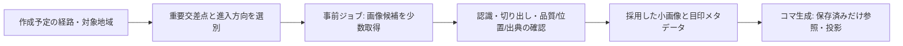

# 目印の表示最適化と画像利用のキー不要PoC（P2-08）

2026-11-11。ユーザー依頼「建物形状/名称を省き、見て分かる少数の記号を載せる」「Mapillaryと画像処理による固有の看板等を検討」に基づく。トークンは未保有。追加回答により、今回はキー不要の比較表示と調査に限定する。コマ生成ごとのAPI/認識処理を避け、重要交差点等を事前に取得・処理して再利用する方針を検討する。

## 今回の到達点と操作

`npm run dev` → 運営者入口の「目印の表示を検証する」→ **/operator/landmarks**。三崎下町の固定31コマで、次を同じ道路形状で比較する。保存済みコースを読み書きする画面ではない。

| 案 | 内容 |
| --- | --- |
| 現在の表示 | 建物形状・目印名称を含む既存表示 |
| 認識できる記号だけ | 建物形状/名称を省く。信号・明示された日本の止まれ標識・バス停から上限1/2/3個。階段は道路の情報として残す |
| 道と進行方向のみ | 道路・進入/退出・中心だけ |

記号案の初期上限2個は比較用の仮値で、参加者への採用決定ではない。通常の参加者・運営者・トップのコマ表示は既存のまま。元の全枝/角度/距離・向き/短い枝の拡大計算、保存形式とDBは変更しない。元が保留のコマは3案とも保留し、写真や記号で形状不足が解消したようには扱わない。今回は通常30m図を比較対象とし、拡大図での記号配置の評価は未実施。

記号は元のOSM記録に基づく。一時停止の制御点だけから止まれ標識を推測せず、神社という施設分類から鳥居を描かない。止まれは交通標識タグJP:330/330-A/330-Bの記録を必要とする。施設の名称や汎用カテゴリの絵を現物の看板として使わない。現在の信号/バス停記録も現地の設置位置・見え方の保証ではない。

優先順は標識→信号→バス停、同種は距離/IDで固定。世界座標で6m未満の近接候補をまとめ、32 SVG単位の記号（実表示では幅に応じて縮小）が全道路や他の記号を隠す場合は省く。記号を少し離す場合は元の位置に点と引出線を残す。この選別の入力は既存コマに収録された最大4候補であり、周辺の全目印を探索し直した結果ではない。上限・近接距離・記号サイズと優先順の最適性は未検証。

## 写真からの切り出し実験

ユーザー提供の `public/mainphotos/shitamati.jpg` を使い、看板を含む領域を手動で指定して、ブラウザCanvasで32/48/64pxへ縦横比を保って縮小する。初期領域は写真右上の看板。入力変更で領域・切り出し結果が変わる。

**手動の領域指定後の自動切り出しであり、画像認識・看板の自動発見・背景除去・OCRは未実装。** 画像の撮影座標/対象物の座標は不明なので、地図へ任意に配置しない。画像のアップロード/永続保存・外部API呼出しを行わず、元の写真ファイルも変更しない。

小さな写真で固有の色や輪郭を使う可能性を比較できるが、文字の読解や現地での識別性を確認したものではない。32pxで判断できない対象を無理に採用しない。汎用記号、切り出し写真、輪郭の簡略化のどれがよいかは同じ実地点で比べる必要がある。

## 事前取得・保存の境界案

この流れは提案で、取得ジョブ/認識モデル/保存先は実装・採用していない。API待ち/推論をコマ生成や参加者のスライド操作に入れない。データがなければ既存道路図と確認できた記号だけで表示する。

比較画面の取得計画は、枝数・近い角度・近接分岐・再訪を使う暫定順位。同じ正のOSMノードを1地点にまとめ、進入隣接ノードが異なる場合は別方向の枠として数える。上限3/5/10/20地点で試算する。仮想の到達点や直線の2枝を重要交差点扱いしない。

固定31コマは16物理ノードにまとまり、このルールでは重要候補13地点。上位5地点でも10進入方向になる。「1方向最大2枚を見る」という仮定なら20枚が候補上限となる。**画像のカバレッジ/有用性を確認した数ではなく、実取得・保存は0件。** 多方向から見えるか、複数画像による測位に足りるかも別問題。単純な交差点でも迷う場所/CP等はあり、運営者の追加指定が必要かは後続で検証する。

| 保存候補 | 扱いの案 |
| --- | --- |
| 交差点/対象範囲・進入方向 | OSMノードだけでなく道路スナップショットの版と道路上の関係を保持。再訪/別コースで再利用 |
| 撮影情報 | 画像ID/出典URL/作者/撮影日時・カメラ位置/向き。カメラ位置を対象物の位置と混同しない |
| 目印情報 | 対象物の位置と位置根拠・分類/検出範囲・見える方向・品質/確認状態 |
| 採用画像 | 少数の切り出し画像。元画像/改変内容/適用ライセンス・帰属・処理版・内容ハッシュと対応 |
| 版/参照 | 道路や画像処理の変更で再確認。保存/公開済み版が参照中の素材を黙って交換・削除しない |

全域全画像の先取りを避け、まず実際に作るコースの重要交差点から始める。生画像の一時保存、方向ごとの取得/採用上限、総容量、期限、失効/元画像削除・権利変更への対応、公開版の参照保持との整合は**未決定**。取得前にAPI条件と素材の利用条件を確認し、値を決める。無期限キャッシュや一括取得が許可されているとは扱わない。将来AWSへ移す場合も画像取得/保存を生成ロジックに直接埋め込まない。今回AWSやストレージSDKは追加しない。

## Mapillary調査（2026-11-11）

一次資料から確認できたことと、このアプリで未確認なことを分ける。

| 論点 | 確認内容と限界 |
| --- | --- |
| 画像内の検出 | [Object detections](https://help.mapillary.com/hc/en-us/articles/115000967191-Object-detections)は画素の分類/対象領域を説明し、画像ID等からAPIで検出情報を取得できるとしている。「その店固有の看板/マスコット」を確実に識別できるという保証ではない |
| 対象物の位置 | [Map features](https://help.mapillary.com/hc/en-us/articles/115002332165-Map-features)は複数画像の検出から位置を復元する。交通標識/一般の街路物等が対象で、カメラGPSの品質にも依存する。任意の看板/モニュメントに同じ位置情報があるとは限らない |
| 認証 | [公式SDKのClient説明](https://mapillary.github.io/mapillary-python-sdk/docs/mapillary.models/mapillary.models.client/)と[公式MapillaryJS](https://github.com/mapillary/mapillary-js)はMapillaryデータ用のトークンを前提とする。今回は保有しておらずAPI未実行。他者のトークン/公開デモの埋込キーは利用していない |
| 画像の利用 | [公式ライセンス説明](https://help.mapillary.com/hc/en-us/articles/115001770409-CC-BY-SA-license-for-open-data)は画像をCC-BY-SAとして、画像/作者へのリンク等の帰属を案内している。切り出しの改変表示や継承条件を含め、実データのライセンス版/現行規約との対応を取得前に確認する |
| 派生メタデータ | [OSM compatibility](https://help.mapillary.com/hc/en-us/articles/115001777705-OpenStreetMap-compatibility)にはOSM編集用の許諾と、別公開の派生メタデータに関する公開/ODbL条件がある。画像自体とは別扱い。閉じたアプリDBへの無条件な転載許可とは解釈しない |
| 詳細条件 | [API文書](https://www.mapillary.com/developer/api-documentation)と[利用規約](https://www.mapillary.com/terms)は今回の閲覧でログインが必要な画面となり、詳細を確認できなかった。APIの現行上限・再取得/保存/削除条件の確認が残る |

三崎・城ヶ島の対象交差点に実画像があるか、撮影が新しいか、看板が写っているか、何方向から見えるかは**未検証**。写真を得られることと、その写真から便利な目印を得られることは別の成立条件。

初回の実データ検証では、Mapillary既存の検出/地物が使えるものを先に確認し、不足する固有看板だけに別の検出/領域分割/OCR等が必要か判断する。独自モデル/クラウド画像APIの選定・課金・精度/処理時間は未決定で、今回は依存も追加しない。対象が分からない/位置根拠が不足する候補は採用せず、形状を生成AIで補作して現物として扱わない。

## 評価と次の承認点

1. 記号上限1/2/3と道路のみを比べ、道の分かりやすさ、余白、目印の識別性を人が確認する。
2. トークンと利用条件の確認後に、三崎の3〜5交差点・必要な進入方向だけで画像/検出/測位情報の有無を調査する。
3. 位置が確認できた少数対象で、固有写真と汎用記号の比較を行う。運営者の確認負担・再利用率/容量・処理時間を測り、初めてモデル・保存量・参加者への採用を決める。

QR/AIによる参加者認証や写真アップロード機能の復活ではない。今回のPoCのレビュー後に停止する。

## 検証記録

| 項目 | 結果 |
| --- | --- |
| 単体 | 392件成功。新規14件は現物の根拠/上限・優先順/重複/道路との重なり/入力保持、交差点の再訪・方向/順位/上限、切り出し境界/縦横比を検証 |
| 型・本番ビルド | 最終ソースで両方成功。依存/lockfile/実行環境の版は変更なし |
| HTTP | 開発/本番で操作前後各40件成功。新ページと旧 /poc の案内、通常の台帳/保存/公開APIの回帰を含む |
| 比較図 | 各モードで31コマ×3案の93比較。道路の全点/枝・進入退出が一致し、元の保留も維持。記号/道路案に建物や施設名ラベルなし。元の値を変更しない |
| 写真 | 32/48/64pxの実ピクセルを確認。手動領域の変更で結果が変わり、透明な余白で縦横比を維持。修正版の本番ではキャッシュ再読込みでも描画 |
| 幅 | 比較/取得計画/写真を320/390/768/1440pxで確認し、横にはみ出さない。PCの3案横並び/スマホの縦並びを目視確認 |
| 通常画面の回帰 | 開発/本番とも6コース全227コマ。通常171図と短い枝56コマ×3幅の拡大168表示、公開停止/再公開、参加開始/記録、CP名の秘匿/撮影/ゴール案内、トップの体験表示を保持 |
| 外部通信/記録 | PoCのMapillary通信0・参加記録の追加0。通常画面の回帰では背景タイルをテスト用応答へ置換 |
| 未実施 | 実Mapillary/API・三崎/城ヶ島のカバレッジ、実物体認識/測位、現地/スマホ実機・AWS |

初回の開発モードで、写真が画面の初期化より先に読み込まれるとCanvasが空になる不具合を検出した。読み込み済み画像の寸法も初期化時に取得するよう修正し、最終検証で成功した。処理が終わる前に検査しないようブラウザ確認も改善した。

自己レビュー：変更は比較PoC/表示の任意指定/入口リンク/検証と文書の24ファイル。生成の形状・道路等7ファイル/写真3点、実DB、mainの版を保持。通常画面の既定表示はsourceのままで、既存の保存値を更新しない。新依存/環境変数/認識モデルを追加せず、利用条件の確認前に画像を取得・保存しない。人による識別性/現地の確認と、通常画面への採用は残る。

## 2026-11-12の後続PoC

トークン設定とルート別の準備/採用方針の承認を受け、[P2-09](route-landmark-poc.md)で実取得・検出領域からの自動切り出し・運営者の採否/専用保存を追加した。本書は前日のキー不要比較の記録。新画面では停止/横断候補を初期採用とし、旧案の1〜3個上限を使わず全候補を選べる。通常参加者への採用は引き続き別の判断とする。
